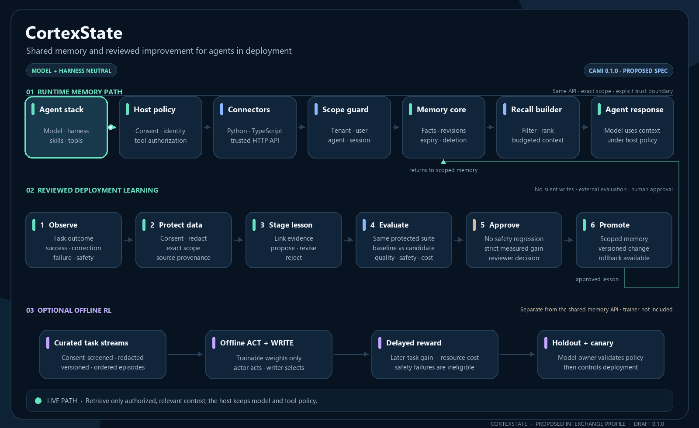
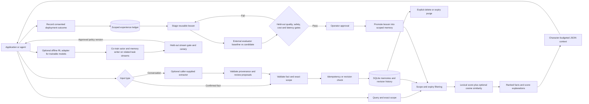

# CortexState

[](https://github.com/bijit-ghosh/CortexState/actions/workflows/ci.yml)

<p align="center"></p>

**One inspectable memory and improvement layer for every model, harness, and skill.**

CortexState is an original, local-first memory toolkit by **Bijit Ghosh**. Store confirmed facts, retrieve scoped context, record deployment outcomes, and promote reusable lessons only after evaluation and approval. Use it through Python, TypeScript, or its authenticated HTTP API; model and harness identities are provenance, not dependencies.

**Version 0.4.0 — developer preview.** CortexState combines scoped memory with a deployment learning ledger, a live operator review console, Python/TypeScript SDKs, and an optional Rust BM25 scorer with a portable Python fallback. Experimental offline RL reward helpers support models whose weights you can train; no RL trainer ships. The repository now publishes **CAMI 0.1.0**, a proposed open agent-memory interchange specification with JSON Schemas. CAMI is a draft from this project, not an adopted industry standard; the current engine does not yet implement portable bundle import/export or CAMI conformance. See [specification](spec/README.md), [interoperability](docs/INTEROPERABILITY.md), [readiness scorecard](docs/READINESS.md), and [governance](GOVERNANCE.md).

[Quick start](#quick-start) · [Architecture](docs/ARCHITECTURE.md) · [Open specification](spec/README.md) · [Interoperability](docs/INTEROPERABILITY.md) · [Readiness](docs/READINESS.md) · [Continual improvement](docs/CONTINUAL-IMPROVEMENT.md) · [Optional RL](docs/RL-TRAINING.md) · [API](docs/API.md) · [Evaluation](evals/README.md) · [Security](SECURITY.md)

## Start with your use case

CortexState keeps useful facts separate from a conversation transcript. Your application decides what deserves to be remembered, which scope owns it, and when it should expire. A later request retrieves a small, inspectable set of facts instead of blindly replaying the entire conversation.

| You want to… | Start here |
| --- | --- |
| Start local memory with one command | [Quick launch and setup](docs/GETTING-STARTED.md) |
| Understand the write, retrieval, and deletion paths | [Architecture and diagrams](docs/ARCHITECTURE.md) |
| Turn production outcomes into reusable, evaluated lessons | [Continual improvement guide](docs/CONTINUAL-IMPROVEMENT.md) |
| Add memory to an existing agent or application | [Integration patterns](docs/INTEGRATION-PATTERNS.md) |
| Build a support assistant, coding helper, or workflow agent | [Practical use cases](docs/USE-CASES.md) |
| Choose scopes, retention, and retrieval settings | [Customization](docs/CUSTOMIZATION.md) |
| Operate the service and handle failures | [Operations](docs/OPERATIONS.md) and [FAQ](docs/FAQ.md) |
| Find all documentation | [Documentation index](docs/README.md) |

### Choose how to run it

| Mode | Best fit | What you provide |
| --- | --- | --- |
| Embedded Python | One trusted application with a local database | Database path and explicit scopes |
| Private HTTP service | Multiple trusted backend clients | Tenant key mapping, persistent storage, application authorization |
| Container recipe | Repeatable local service setup | Docker, credentials, and the named data volume |

All three use the same memory engine. There is no CortexState hosted account or managed cloud service in this release.

## What you can do

| Need | CortexState behavior |
| --- | --- |
| Remember preferences across conversations | SQLite persistence with tenant, user, agent, and session scopes |
| Keep customers separated | Exact scope matching; HTTP keys map to tenants on the server |
| Retry a write safely | Idempotency keys detect duplicate requests and conflicting payloads |
| Correct a remembered fact | Revision-checked updates and inspectable previous versions |
| Retrieve useful context | Unicode lexical matching, metadata filters, optional embedding similarity |
| Understand a search result | Separate lexical and semantic score contributions |
| Bound prompt context | JSON context packed into an exact character limit |
| Control retention | Expiry exclusion, explicit purge, and deletion of history/replay records |
| Use a different model | Supply your own embedding or fact-extraction callable |
| Connect another runtime | Python HTTP client and JavaScript client for trusted backend services |
| Accelerate BM25 ranking | Optional Rust companion wheel scores a document batch; Python reference path remains available |
| Learn from deployment outcomes | Record consented results and provenance without storing full transcripts |
| Improve across models, harnesses, and skills | Stage reusable lessons through a shared API; no provider-specific model assumptions |
| Protect quality while improving | Compare candidate and baseline on a held-out suite; require no safety, quality, token, or latency regression plus one strict gain |
| Control what becomes memory | Reviewer approval is required; rollback removes the active lesson while retaining its scorecard |
| Train memory policy when you own the weights | Optional actor/writer RL reward helpers; no model trainer or weight updates are bundled |

## Quick start

Already installed? Start the dashboard with a disposable sample workspace:

```bash
cortexstate demo
```

Open the printed dashboard URL and paste the generated disposable service key. The console shows live counts, scoped memories, revision history, search scores, and model tools when a generation provider is configured. [Dashboard guide](docs/DASHBOARD.md) · [API and model setup](docs/MODELS.md) · [SDK packages](docs/SDK.md).

Python 3.10 or later. Install from this repository; no PyPI or npm release is claimed.

```bash
git clone https://github.com/bijit-ghosh/CortexState.git
cd CortexState
python -m pip install .
python -m examples.quickstart
```

```python
from cortexstate import Memory, Scope

memory = Memory("my-memory.db")
scope = Scope(tenant="my-team", user="alice", agent="assistant")

fact = memory.add(
    "Alice prefers decaf coffee after noon",
    scope=scope,
    metadata={"source": "user-confirmed", "kind": "preference"},
    idempotency_key="conversation-42-fact-1",
)

matches = memory.search("coffee", scope=scope)
context = memory.context("coffee", scope=scope, max_chars=1200)
print(context["data"])

memory.update(
    fact["id"], "Alice now prefers tea after noon",
    scope=scope, expected_revision=fact["revision"],
)
```

Persist only facts your application is authorized to remember. Retrieved text is untrusted data: give your model clear instructions to treat it as reference material, and keep tool authorization outside the model's memory.

## How it works



The library executes in your process. The HTTP layer adds key authentication and tenant assignment. Model-generated facts and improvement lessons remain proposals until reviewed and evaluated; they are never silently committed. CortexState does not train model weights or autonomously tune a live agent: your deployment records outcomes, runs the evaluator, and approves changes. If you own trainable weights, the separate RL lane can optimize actor exploration and memory writing offline; the same shared memory API remains available to closed model APIs. [Detailed architecture](docs/ARCHITECTURE.md) · [continual improvement design](docs/CONTINUAL-IMPROVEMENT.md) · [RL training design](docs/RL-TRAINING.md).

## Run the service

Generate a secret with `python -c "import secrets; print(secrets.token_urlsafe(32))"`. Set a JSON mapping of that secret to a tenant. Replace `YOUR_GENERATED_SECRET` below; never commit it.

PowerShell:

```powershell
$env:CORTEXSTATE_KEYS = '{"YOUR_GENERATED_SECRET":"my-team"}'
python -m cortexstate --db cortexstate.db serve
```

Bash:

```bash
export CORTEXSTATE_KEYS='{"YOUR_GENERATED_SECRET":"my-team"}'
python -m cortexstate --db cortexstate.db serve
```

The server rejects empty key maps and keys shorter than 32 ASCII characters. It listens on `127.0.0.1:8787`. Use `docker compose up --build` for the supplied container configuration; the same environment variable is required. Container execution is a separate validation target, not implied by passing Python tests.

```python
import os
from cortexstate.client import Client

client = Client("http://127.0.0.1:8787", os.environ["CORTEXSTATE_API_KEY"])
client.call("add", scope={"user": "alice"}, text="Alice prefers tea")
print(client.call("search", scope={"user": "alice"}, query="tea"))
```

Set `CORTEXSTATE_API_KEY` in your client process to the generated secret used in the server's mapping. The API assigns the tenant; clients must not supply it. Keys authorize all users within that tenant, so use a trusted backend and enforce end-user authorization there.

JavaScript (Node.js 20+; source import, not a published npm package):

```javascript
import {CortexState} from './sdk/javascript/index.mjs';
const memory = new CortexState({apiKey: process.env.CORTEXSTATE_API_KEY});
const facts = await memory.call('search', {
  scope: {user: 'alice'}, query: 'tea', limit: 5,
});
console.log(facts);
```

## Customize it

Choose your scope layout, metadata, TTL, retrieval weights, embedding provider, and extraction workflow. Search supports word overlap or BM25, optionally blended with embedding similarity. Configure model environment variables to enable the bundled OpenAI adapter, or supply your own provider callable. [Customization guide](docs/CUSTOMIZATION.md) and [model setup](docs/MODELS.md) describe both paths.

## Verify it

```bash
python -m unittest discover -s tests -v
node --test sdk/javascript/test.mjs
python -m evals.run --out work/eval.json
```

The eval writes a fresh report with actual outcomes, latency, environment information, and source hashes. It refuses to overwrite an existing result. The public fixture tests basic retrieval and isolation; it does not establish LLM quality, token savings, or superiority to other products. [Protocol and recorded results](evals/README.md).

## A complete memory lifecycle

Run `python -m examples.support_workflow` for a synthetic customer-support example. It stores a confirmed preference, retries the same write, assembles context, corrects the preference using its revision, inspects history, checks customer isolation, and deletes the record. It requires no model key and makes no external calls. [Example catalog](examples/README.md).

## Design principles

- **Explicit ownership:** every read and write belongs to one exact scope.
- **Reviewable change:** facts have IDs, revisions, provenance metadata, and history.
- **Controlled recall:** retrieval explains its scores and context has a fixed character budget.
- **Deliberate retention:** expiry and deletion have documented, distinct effects.
- **Provider choice:** model integrations are supplied by your application; the default core is offline.
- **Evidence before claims:** published results name the fixture, environment, and limitations.
- **Open interchange:** CAMI versions its record and bundle schemas publicly; interoperability claims stay tied to tested versions and mappings.

## Project map

```text
cortexstate/       Memory engine, deployment-learning ledger, HTTP server, client, CLI
sdk/javascript/   JavaScript client and transport tests
tests/            Persistence, isolation, concurrency, lifecycle, API tests
examples/         Runnable local workflow
evals/            Public fixture, runner, measured report
docs/             Architecture, API contract, customization, operations, roadmap
.github/          Windows/Linux CI
```

## Ownership and reference

CortexState is created and maintained by **Bijit Ghosh**, with original project code available under the [MIT license](LICENSE).
