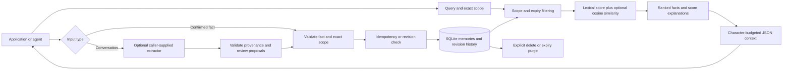

# CortexState

**Memory your application can inspect, scope, revise, and forget.**

CortexState is an original, local-first memory toolkit by **Bijit Ghosh**. Store confirmed facts, retrieve relevant context, and track changes without tying your application to one model provider. Run the Python library in your application or expose it through an authenticated HTTP service.

**Status: 0.1.0 developer preview.** The core works without API keys, model calls, or runtime dependencies. This is a working foundation, not feature parity with an established managed memory platform. See [capabilities and roadmap](docs/CAPABILITIES.md) before choosing it for production.

[Quick start](#quick-start) · [Architecture](docs/ARCHITECTURE.md) · [API](docs/API.md) · [Customization](docs/CUSTOMIZATION.md) · [Evaluation](evals/README.md) · [Security](SECURITY.md)

## What you can do

| Need | CortexState behavior |
| --- | --- |
| Remember preferences across conversations | SQLite persistence with tenant, user, agent, and session scopes |
| Keep customers separated | Exact scope matching; HTTP keys map to tenants on the server |
| Retry a write safely | Idempotency keys detect duplicate requests and conflicting payloads |
| Correct a remembered fact | Revision-checked updates and inspectable previous versions |
| Retrieve useful context | Unicode lexical matching, metadata filters, optional embedding similarity |
| Understand a search result | Separate lexical and semantic score contributions |
| Bound prompt context | JSON context packed into an exact character limit |
| Control retention | Expiry exclusion, explicit purge, and deletion of history/replay records |
| Use a different model | Supply your own embedding or fact-extraction callable |
| Connect another runtime | Python HTTP client and JavaScript client for trusted backend services |

## Quick start

Python 3.10 or later. Install from this repository; no PyPI or npm release is claimed.

```bash
git clone https://github.com/bijit-ghosh/CortexState.git
cd CortexState
python -m pip install .
python -m examples.quickstart
```

```python
from cortexstate import Memory, Scope

memory = Memory("my-memory.db")
scope = Scope(tenant="my-team", user="alice", agent="assistant")

fact = memory.add(
    "Alice prefers decaf coffee after noon",
    scope=scope,
    metadata={"source": "user-confirmed", "kind": "preference"},
    idempotency_key="conversation-42-fact-1",
)

matches = memory.search("coffee", scope=scope)
context = memory.context("coffee", scope=scope, max_chars=1200)
print(context["data"])

memory.update(
    fact["id"], "Alice now prefers tea after noon",
    scope=scope, expected_revision=fact["revision"],
)
```

Persist only facts your application is authorized to remember. Retrieved text is untrusted data: give your model clear instructions to treat it as reference material, and keep tool authorization outside the model's memory.

## How it works



The library executes in your process. The HTTP layer adds key authentication and tenant assignment. Extraction is a separate proposal step; it never silently writes a model's output into memory. [Detailed architecture and trust boundaries](docs/ARCHITECTURE.md).

## Run the service

Generate a secret with `python -c "import secrets; print(secrets.token_urlsafe(32))"`. Set a JSON mapping of that secret to a tenant. Replace `YOUR_GENERATED_SECRET` below; never commit it.

PowerShell:

```powershell
$env:CORTEXSTATE_KEYS = '{"YOUR_GENERATED_SECRET":"my-team"}'
python -m cortexstate --db cortexstate.db serve
```

Bash:

```bash
export CORTEXSTATE_KEYS='{"YOUR_GENERATED_SECRET":"my-team"}'
python -m cortexstate --db cortexstate.db serve
```

The server rejects empty key maps and keys shorter than 32 ASCII characters. It listens on `127.0.0.1:8787`. Use `docker compose up --build` for the supplied container configuration; the same environment variable is required. Container execution is a separate validation target, not implied by passing Python tests.

```python
import os
from cortexstate.client import Client

client = Client("http://127.0.0.1:8787", os.environ["CORTEXSTATE_API_KEY"])
client.call("add", scope={"user": "alice"}, text="Alice prefers tea")
print(client.call("search", scope={"user": "alice"}, query="tea"))
```

Set `CORTEXSTATE_API_KEY` in your client process to the generated secret used in the server's mapping. The API assigns the tenant; clients must not supply it. Keys authorize all users within that tenant, so use a trusted backend and enforce end-user authorization there.

JavaScript (Node.js 20+; source import, not a published npm package):

```javascript
import {CortexState} from './sdk/javascript/index.mjs';
const memory = new CortexState({apiKey: process.env.CORTEXSTATE_API_KEY});
const facts = await memory.call('search', {
  scope: {user: 'alice'}, query: 'tea', limit: 5,
});
console.log(facts);
```

## Customize it

Choose your scope layout, metadata, TTL, retrieval weights, embedding provider, and extraction workflow. The default server runs lexical retrieval; embedder injection is available through the Python API and a custom server entry point. [Customization guide](docs/CUSTOMIZATION.md) includes working patterns and explicit boundaries.

## Verify it

```bash
python -m unittest discover -s tests -v
node --test sdk/javascript/test.mjs
python -m evals.run --out work/eval.json
```

The eval writes a fresh report with actual outcomes, latency, environment information, and source hashes. It refuses to overwrite an existing result. The public fixture tests basic retrieval and isolation; it does not establish LLM quality, token savings, or superiority to other products. [Protocol and recorded results](evals/README.md).

## Project map

```text
cortexstate/       Memory engine, extraction boundary, HTTP server, client, CLI
sdk/javascript/   JavaScript client and transport tests
tests/            Persistence, isolation, concurrency, lifecycle, API tests
examples/         Runnable local workflow
evals/            Public fixture, runner, measured report
docs/             Architecture, API contract, customization, operations, roadmap
.github/          Windows/Linux CI
```

## Ownership and reference

CortexState is maintained by Bijit Ghosh and licensed under [MIT](LICENSE). [Mem0](https://github.com/mem0ai/mem0) was consulted as a public product-capability reference. This implementation does not copy its source, documentation, artwork, benchmark results, or branding. CortexState is not affiliated with Mem0. See [provenance](PROVENANCE.md).

Contributions should include a concrete use case and evidence. Read [CONTRIBUTING.md](CONTRIBUTING.md) and the [security policy](SECURITY.md).
