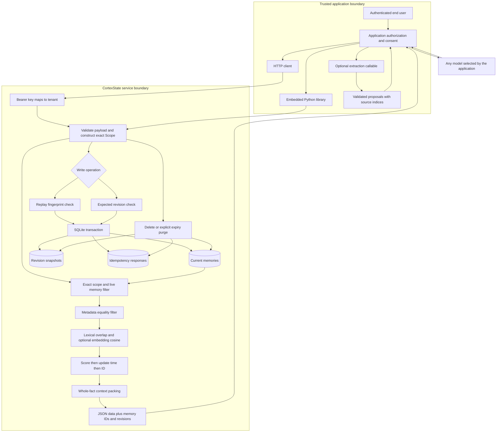
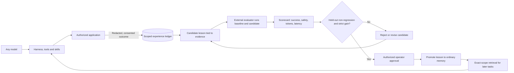
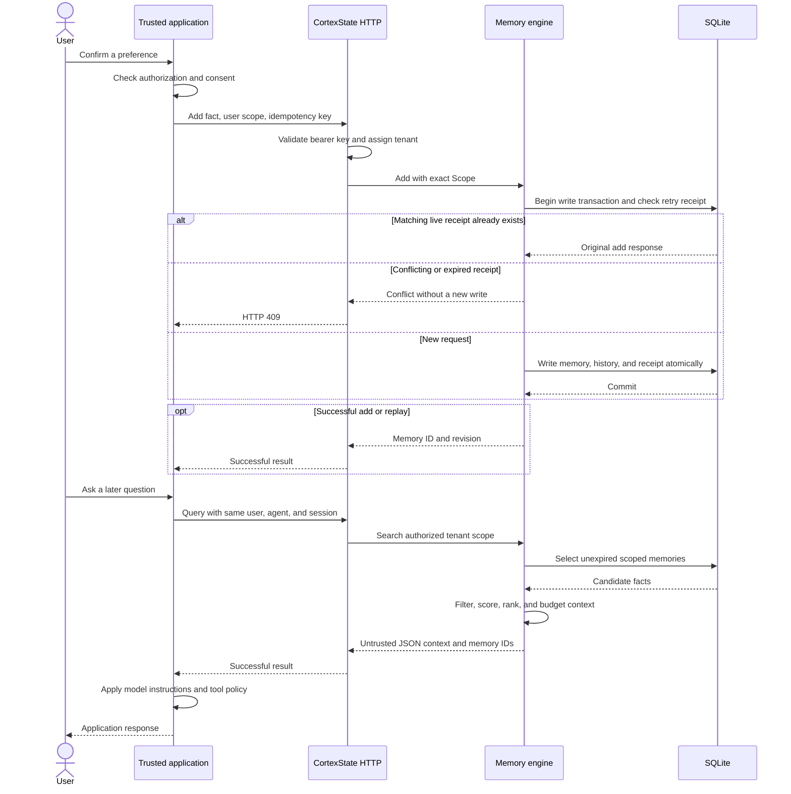
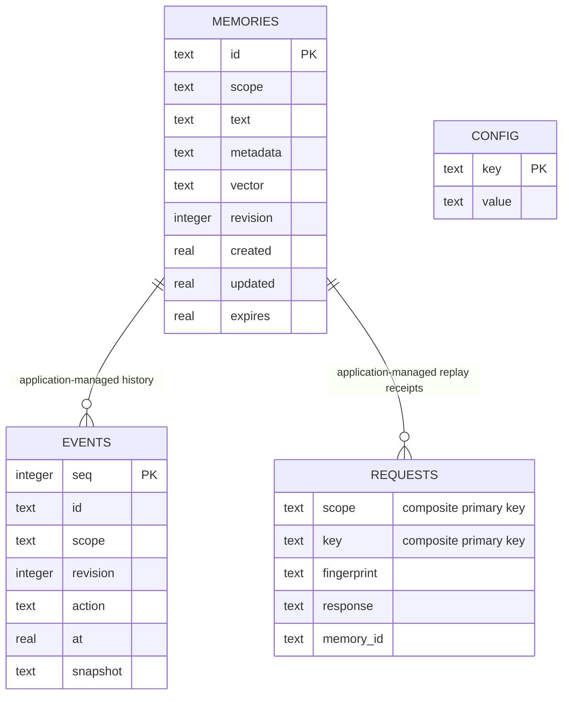
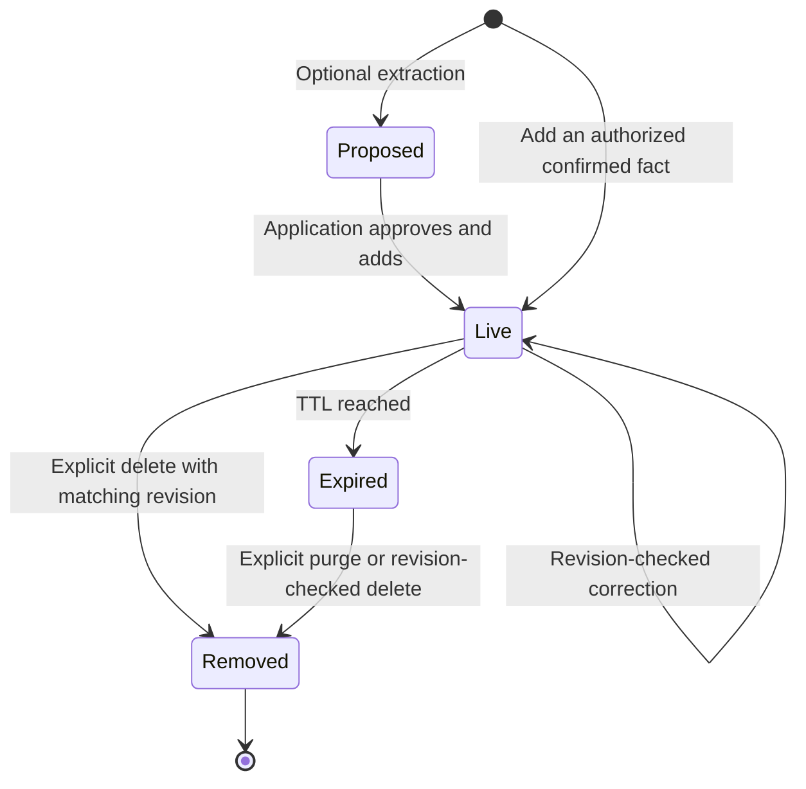
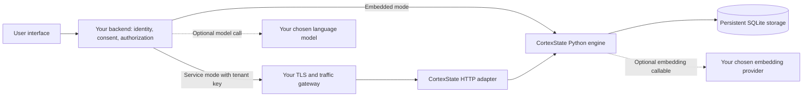

# Architecture

## Components and boundaries

Version 0.4 adds an outcome ledger and evidence-gated lesson lifecycle. The HTTP API is the interoperability boundary: models, harnesses, and skills can change while the same exact-scope memory and outcome records remain available. Python remains the reference implementation; TypeScript and other runtimes can use the HTTP API. Version 0.3 added an optional batch BM25 scorer in Rust, with a portable Python fallback. The dashboard polls scoped statistics and records every three seconds, and sends explicit model requests to the server when enabled. Provider credentials remain server-side. The dashboard stores no service key in browser storage. See [dashboard](DASHBOARD.md) and [model configuration](MODELS.md).

The in-process Python library bypasses HTTP authentication: possession of the database is the trust boundary. `Scope` is mandatory for all memory operations. Neither the library nor HTTP API supports wildcard tenants or users.

## Deployment learning loop

The ledger stores short experiences, provenance, evidence links, candidate lessons, and caller-submitted scorecards in the same SQLite database. Only a promoted lesson enters ordinary memory retrieval. The HTTP contract does not depend on the model, harness, skill format, or provider. Integrators still need to map task completion signals into the shared outcome schema and call the API; CortexState does not automatically inspect arbitrary agent traces.

The evaluator runs outside CortexState. The service checks declared held-out status, scorecard ranges, zero reported safety regressions, no regression in success/tokens/latency, and at least one strict improvement. These checks are a promotion gate, not proof of evaluator independence, statistical significance, or suite integrity. Your backend must protect evaluator credentials and test data, authorize the approver, and enforce immutable acceptance criteria.

## Request sequence

This example uses HTTP; an embedded application starts at the engine step after constructing its own scope.

## Storage model

The learning ledger adds `learning_experiences`, `learning_candidates`, `learning_evidence`, and `learning_evaluations` tables in the same SQLite database. Experiences and candidates always carry the serialized exact scope. A candidate links to one or more same-scope experience IDs; an evaluation belongs to that candidate. Promotion creates an ordinary memory record with the candidate ID and evaluation provenance in metadata.

These are logical relationships maintained by engine transactions, not all SQL foreign-key constraints. `scope` is a serialized four-element identifier tuple. Metadata, vectors, snapshots, and replay responses are serialized JSON. `CONFIG` records embedding identity and dimensions. There is no separate vector database in this release.

## Memory lifecycle

`Proposed` is an application-level object, not a database row. `Expired` is computed from the timestamp, not a background job. Expired records remain available through history until removed. Re-adding a deleted fact creates a new ID; removed memories are not restored automatically.

## Deployment and responsibility

The gateway and model providers are application infrastructure, not bundled CortexState services. The bundled Compose configuration exposes only a loopback port. A browser should call your backend, which keeps tenant credentials private and enforces per-user permissions.

## Write semantics

1. Validate size, metadata, and retention inputs.
2. Acquire a SQLite write transaction. An add with an existing idempotency key returns the original response if its fingerprint matches and it has not expired. A conflicting payload returns a conflict.
3. Optionally compute an embedding and enforce the database's embedding identity and dimensionality.
4. Store the fact and its initial history event atomically. Updates compare `expected_revision` before changing text, embedding, revision, and history.
5. Commit before returning. An exception rolls back the operation.

An idempotent replay is a receipt for the original add, not a read of the latest revision. Read the ID to obtain current state. Deleting or purging a memory removes its idempotency entries, so reusing that key afterward creates a new memory. These semantics require callers to stop retries when they intentionally delete data.

Embeddings run inside an add transaction to preserve the replay guarantee; slow provider calls therefore hold the single writer lock. Use a fast local callable or a prepared embedding cache for this preview. A queued ingestion worker is future work.

## Retrieval

The default lexical signal is the fraction of unique query words present in a fact. Word splitting is Unicode-aware and case-insensitive, without stemming or language-specific NLP. Search can select `ranking="bm25"`: k1=1.2, b=0.75, with document frequencies calculated over live, scoped, metadata-filtered records. The scorer is an optional PyO3 Rust extension in packaged native builds; the Python reference scorer remains the portable fallback. Both use identical token inputs and formulas, with a parity test in CI. The raw BM25 score is normalized as `raw / (1 + raw)` before blending. This adds ranking, not an inverted index. With an embedder, normalized cosine similarity is clamped at zero and combined as:

`score = (1 - semantic_weight) * lexical + semantic_weight * semantic`

The weight defaults to 0.5. Without an embedder, only lexical scoring is used. Nonpositive scores are omitted. Ties sort by updated time, then memory ID. Results are deterministic for the same stored snapshot and deterministic embedder; independently created UUIDs can change tie order across new stores.

Search scans every visible memory in one exact scope. It is suitable for modest local datasets, not a vector index or a claim of million-memory scale. Context packing visits ranked results, skips facts that do not fit, and serializes complete facts within `max_chars`. This is a character limit, not a model token guarantee.

## Lifetime and forgetting

Expiry excludes facts from get, list, search, and context immediately. History remains inspectable until explicit purge. No background scheduler is installed. Call `purge_expired(scope=...)` at the cadence your application requires. Delete and purge remove current rows, revision snapshots, and replay payloads together. SQLite free pages, backups, and application logs have separate retention requirements.

## Failure behavior

| Failure | Behavior |
| --- | --- |
| Missing/invalid API key | HTTP 401, no memory operation |
| Client supplies tenant | HTTP 400 |
| Wrong exact scope or missing ID | HTTP 404 |
| Stale revision or conflicting retry | HTTP 409 |
| Invalid input or mismatched embedding dimensions | Rejected; writes roll back |
| Expired fact | Invisible to live retrieval; explicit purge removes history |
| Database/provider failure | No success receipt; HTTP 500 for unexpected service failures |

## Deliberate limits

No automatic agent execution, evaluator, background learner, model-weight update, distributed transactions, automatic contradiction resolution, graph engine, managed cloud control plane, SSO, role hierarchy, or learned reranker is implemented. The stdlib HTTP adapter is intended for local/private evaluation behind a properly configured gateway if exposed remotely. The [operations guide](OPERATIONS.md) covers deployment responsibilities.
