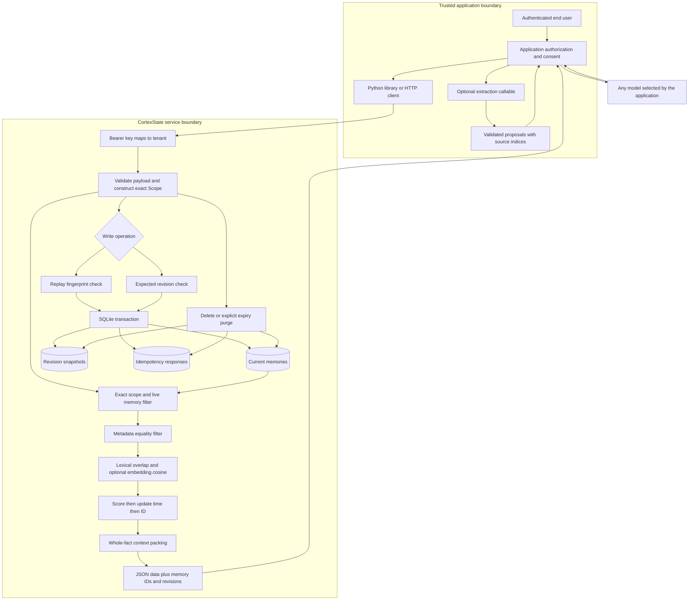

# Architecture

## Components and boundaries

The in-process Python library bypasses HTTP authentication: possession of the database is the trust boundary. `Scope` is mandatory for all memory operations. Neither the library nor HTTP API supports wildcard tenants or users.

## Write semantics

1. Validate size, metadata, and retention inputs.
2. Acquire a SQLite write transaction. An add with an existing idempotency key returns the original response if its fingerprint matches and it has not expired. A conflicting payload returns a conflict.
3. Optionally compute an embedding and enforce the database's embedding identity and dimensionality.
4. Store the fact and its initial history event atomically. Updates compare `expected_revision` before changing text, embedding, revision, and history.
5. Commit before returning. An exception rolls back the operation.

An idempotent replay is a receipt for the original add, not a read of the latest revision. Read the ID to obtain current state. Deleting or purging a memory removes its idempotency entries, so reusing that key afterward creates a new memory. These semantics require callers to stop retries when they intentionally delete data.

Embeddings run inside an add transaction to preserve the replay guarantee; slow provider calls therefore hold the single writer lock. Use a fast local callable or a prepared embedding cache for this preview. A queued ingestion worker is future work.

## Retrieval

The default lexical signal is the fraction of unique query words present in a fact. Word splitting is Unicode-aware and case-insensitive, without stemming, BM25, or language-specific NLP. With an embedder, normalized cosine similarity is clamped at zero and combined as:

`score = (1 - semantic_weight) * lexical + semantic_weight * semantic`

The weight defaults to 0.5. Without an embedder, only lexical scoring is used. Nonpositive scores are omitted. Ties sort by updated time, then memory ID. Results are deterministic for the same stored snapshot and deterministic embedder; independently created UUIDs can change tie order across new stores.

Search scans every visible memory in one exact scope. It is suitable for modest local datasets, not a vector index or a claim of million-memory scale. Context packing visits ranked results, skips facts that do not fit, and serializes complete facts within `max_chars`. This is a character limit, not a model token guarantee.

## Lifetime and forgetting

Expiry excludes facts from get, list, search, and context immediately. History remains inspectable until explicit purge. No background scheduler is installed. Call `purge_expired(scope=...)` at the cadence your application requires. Delete and purge remove current rows, revision snapshots, and replay payloads together. SQLite free pages, backups, and application logs have separate retention requirements.

## Failure behavior

| Failure | Behavior |
| --- | --- |
| Missing/invalid API key | HTTP 401, no memory operation |
| Client supplies tenant | HTTP 400 |
| Wrong exact scope or missing ID | HTTP 404 |
| Stale revision or conflicting retry | HTTP 409 |
| Invalid input or mismatched embedding dimensions | Rejected; writes roll back |
| Expired fact | Invisible to live retrieval; explicit purge removes history |
| Database/provider failure | No success receipt; HTTP 500 for unexpected service failures |

## Deliberate limits

No distributed transactions, automatic contradiction resolution, graph engine, managed cloud control plane, SSO, role hierarchy, or learned reranker is implemented. The stdlib HTTP adapter is intended for local/private evaluation behind a properly configured gateway if exposed remotely. The [operations guide](OPERATIONS.md) covers deployment responsibilities.
