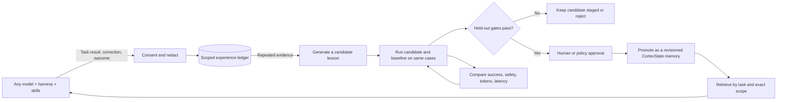

# Continual improvement across models and agent stacks

CortexState can help an agent improve after deployment by preserving evidence from completed tasks, turning repeatable outcomes into candidate lessons, and promoting only changes that pass a fixed comparison. The loop is exposed through a scoped HTTP API and Python/JavaScript clients, so a model, harness, or skill package can change without changing the learning record format.

This improves the agent's **external memory and procedures**. It does not update model weights, fine-tune a provider model, or make an unattended self-modifying agent. Your application or evaluation service decides when to collect outcomes, which evaluator to trust, and who can approve a promotion.

## The deployment learning loop



1. **Observe an outcome.** After a real task, record a concise result such as success, failure, correction, blocked, or unsafe. Include model, harness, skill, and app versions as optional provenance. Never upload credentials or a whole transcript by default.
2. **Create a reusable candidate.** A caller can use any model, a rule, or a human to turn one or more same-scope experiences into a procedure, preference, constraint, or tool strategy. Candidate text is staged as untrusted data.
3. **Evaluate against a frozen baseline.** Run both the current behavior and the candidate on the same versioned suite. The evaluation API requires a held-out suite identifier and records success counts, safety regressions, tokens, latency, and evaluator label.
4. **Promote with approval.** The current gate requires no drop in task success, token use, or latency; zero reported safety regressions; and a strict gain in at least one of success, tokens, or latency. A reviewer label is required. The trusted backend must enforce who is allowed to approve; `approved_by` is an audit label, not an authorization mechanism.
5. **Monitor and roll back.** Retrieve the promoted lesson for relevant tasks, record deployed outcomes, compare canary behavior, and use revision-checked rollback if production evidence regresses.

## Record experiences from any stack

Every endpoint requires the same exact tenant/user/agent/session scope as normal memory operations. The provider and harness fields are optional source metadata, not routing requirements. That keeps a lesson usable after switching models, tools, skills, or orchestration frameworks.

```python
import os
from cortexstate import Client

client = Client(os.environ["CORTEXSTATE_URL"], os.environ["CORTEXSTATE_API_KEY"])
scope = {"user": "alice", "agent": "support", "session": "persistent"}

episode = client.record_experience(
    scope=scope,
    task="resolve_billing_question",
    outcome="correction",
    summary="The first answer missed the refund window; checking the policy date fixed it.",
    consent=True,
    event_key="ticket-8421-attempt-1",
    source={"model": "provider/model-version", "harness": "workflow-v3",
            "skills": ["billing-help@12"], "app_version": "2026.11"},
    measures={"input_tokens": 1820, "output_tokens": 360, "latency_ms": 940},
)

candidate = client.propose_lesson(
    scope=scope,
    evidence_ids=[episode["id"]],
    category="procedure",
    content="For refund questions, retrieve the purchase date and current refund window before answering.",
)
```

`consent=True` is an explicit caller assertion. The API cannot infer user consent or remove sensitive content from summaries. Keep collection opt-in, redact at the application boundary, enforce retention, and use a separate scope for each user. Experience summaries and retrieved lessons are untrusted data; never let them override system instructions or tool permissions.

## Evaluate before promotion

Use the same held-out cases for the active baseline and candidate, and run the evaluator outside the model generating the lesson. The evaluation request below is an API shape example; its numbers are placeholders, not measured CortexState results.

```python
scorecard = client.evaluate_lesson(
    candidate["id"], scope=scope,
    suite="support-holdout-2026-11-v1",
    evaluator="support-evaluator-v2",
    heldout=True,
    total=100,
    baseline_passed=72,
    candidate_passed=75,
    safety_regressions=0,
    baseline_tokens=1200,
    candidate_tokens=1180,
    baseline_latency_ms=840,
    candidate_latency_ms=820,
)

if scorecard["evaluation"]["passed"]:
    client.promote_lesson(candidate["id"], scope=scope, approved_by="review-1842")
```

The API records the scorecard and enforces the non-regression/strict-gain gate. The caller remains responsible for evaluator independence, suite immutability, statistical confidence, and authorization. For high-impact tasks, require stronger evidence than a raw pass count: repeated runs, confidence intervals, adversarial cases, and human review. Keep acceptance tests and final holdouts outside the agent's write access.

To revert a promoted lesson, fetch it to get its current memory revision, then call `rollback_lesson(candidate_id, expected_revision=...)`. This deletes the active lesson using revision protection while retaining the candidate scorecard for audit. Deleting an experience also deletes candidates and promoted lessons derived from that evidence.

## Train agents to push a capability frontier

Treat deployment as a source of candidate training examples, not as an automatic reward signal. A practical agent-improvement program can use this sequence:

1. Maintain a versioned task set with realistic successes, failures, user corrections, tool errors, and safety edge cases. Add new cases from consented deployment outcomes after redaction and review.
2. Freeze the baseline agent, tools, skills, prompt policy, evaluator, and test data for each comparison. Record model/harness/skill versions in provenance so results remain explainable.
3. Propose one small change at a time: a reusable fact, retrieval policy, procedure, skill instruction, or tool-selection rule. Avoid changing the evaluator and candidate in the same iteration.
4. Run baseline and candidate on identical cases. Report task success, safety regressions, token use, latency, and variance separately. Keep safety as a hard gate rather than a reward that can be traded for a higher score.
5. Keep only Pareto improvements: no worse task success, safety, tokens, or latency, with at least one strict improvement. Use a protected final suite after tuning; never let the optimizer rewrite acceptance criteria.
6. Canary the approved candidate, compare real outcomes to the offline result, then promote broadly or roll back. Set iteration, spend, token, time, and change-size budgets so a plateau or repeated failure stops the loop.

This hill-climb improves **retrieval policy and reusable agent procedures** with external memory. To train model weights, export a separately consented and scrubbed dataset to your chosen training system, train there, and re-run the same protected evaluations before deployment. CortexState does not fine-tune models.

For trainable open-weight policies, a separate optional RL lane can co-train task solving and memory writing over related task streams. The actor earns task utility plus a capped, verifier-confirmed discovery signal; the writer earns credit for measured improvement on later tasks. This does not apply to hosted APIs whose weights cannot be updated. See the [RL training design](RL-TRAINING.md) for the reward, data, evaluation, and implementation boundaries.

## Model and harness interoperability

The language-neutral HTTP endpoints are `POST /v1/learning/record`, `/list`, `/candidates`, `/propose`, `/evaluate`, `/promote`, `/reject`, `/rollback`, and `/delete-experience`. Python exposes `LearningLedger` for embedded use and named methods on `Client`; JavaScript exposes matching methods. Other runtimes can use the API directly. An MCP adapter can expose the same operations as tools, but a bundled MCP server is not included yet.

The ledger records experiences and learning candidates separately from active memories. Only explicitly promoted lessons enter ordinary retrieval. Provider and harness identity are evidence fields; they do not determine whether a lesson can be recalled. Exact tenant/user/agent/session isolation still applies, so lessons never flow across users or tenants unless your authorized application deliberately copies reviewed content.

## Current boundaries

- No background worker, automatic transcript capture, model-weight training, hosted evaluator, or cross-tenant learning is bundled. Your deployment calls the record/evaluate/promote endpoints or schedules that work.
- The `heldout` flag, evaluator name, and score values are supplied by the caller. The current tenant-key model has no per-operation roles; keep evaluator and approval authorization in a trusted backend, separate from agent credentials, and enforce immutable suites there.
- The dashboard provides outcome capture and candidate review, but does not execute candidate generation or evaluation; use the API/SDK and a trusted external evaluator for those stages.
- SQLite is suitable for local/private evaluation. Multi-worker distributed learning, queueing, production migrations, and managed rollout control are not included.
