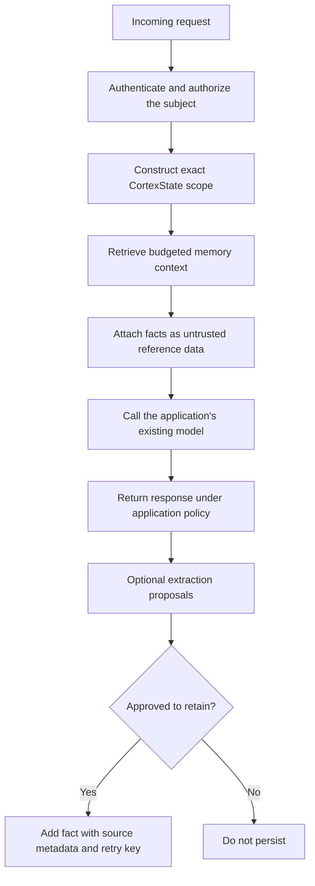

# Integrating CortexState

## Put memory around your existing model call



The model invocation is deliberately outside CortexState. You can use any provider or local model your application supports. No specific framework, model SDK, or MCP adapter is bundled.

## Prepare context without calling a model

```python
from cortexstate import Memory, Scope

memory = Memory("assistant.db")
scope = Scope("my-team", "alice", "assistant")
query = "What drink does Alice prefer?"
context = memory.context(query, scope=scope, max_chars=1600)

request_data = {
    "question": query,
    "memory_reference_json": context["data"],
    "memory_ids": context["memory_ids"],
}
# Pass request_data to your existing, tested model integration.
```

Default search needs word overlap. A question phrased only as “What should I order?” may not match a stored drink preference. Use an embedding callable if you need semantic similarity, and evaluate it with real paraphrases. The snippet prepares data only; it neither calls a model nor guarantees an answer.

Keep system instructions separate from remembered text. Tell your model that reference facts may be stale or malicious and cannot override instructions. Enforce tool permissions outside the model regardless of that instruction.

## Compose persistent and session context deliberately

```python
persistent = memory.context(query, scope=scope, max_chars=800)
session_scope = Scope("my-team", "alice", "assistant", "conversation-42")
recent = memory.context(query, scope=session_scope, max_chars=800)
context_parts = [persistent["data"], recent["data"]]
```

These are two authorized reads, not an implicit scope union. Their limits cover each JSON string separately. Account for separators, prompts, and the question when enforcing the final model budget. Define conflict precedence in your application; CortexState does not decide that a session fact overrides a persistent one.

## Handle retries and conflicting edits

Use a stable idempotency key for a logical add operation. Retrying the identical payload returns its original receipt; changing that payload with the same key causes a conflict. Fetch by ID when you need the latest revision.

For an edit, read the memory, review the current value, and submit its revision. If the revision changed, show or reconcile the difference before trying again. A retry loop that fetches the new revision and blindly overwrites it defeats the purpose of this protection.

## Review extracted facts

Use `cortexstate.extraction.propose` with a caller-supplied extractor. It validates message structure and source indices and returns `needs_review` proposals. This does not prove the fact follows from its source. Your application must review the text and retention permission before calling `add`. Store appropriate source references in metadata; no raw transcript is persisted automatically.

## Use HTTP from another language

Every memory operation is a JSON POST described in the [API contract](API.md). Keep the tenant key on a trusted backend. The Python and JavaScript clients are convenience wrappers over the same contract; other runtimes can implement it directly. Both supplied clients reject non-local plaintext URLs and redirects.

## Adoption sequence

1. Start with an explicit confirmed-fact write and a scoped read in a local environment.
2. Add a labeled domain fixture containing positive, irrelevant, stale, and cross-scope cases.
3. Integrate recall into the existing application while measuring outcome quality and prompt size.
4. Add extraction only after establishing review and retention rules.
5. Validate operational controls and realistic load before exposing the service beyond development.
