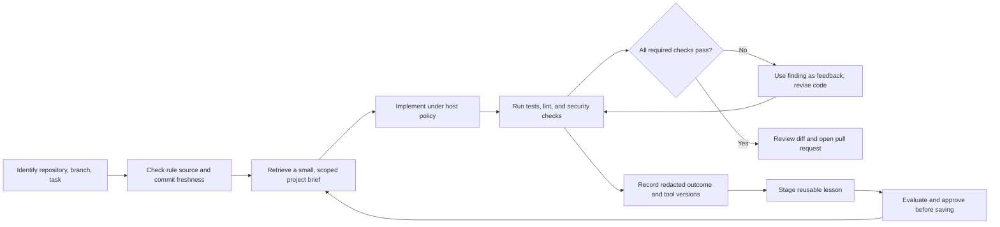

# Practical CortexState use cases

These are application patterns supported by the existing library and API. They are not prebuilt products, domain compliance claims, or framework integrations.

## Customer support continuity

Remember a customer's confirmed language preference, contact channel, or troubleshooting steps already completed. Use tenant for the support organization, user for the customer ID, and agent for the support application. Keep preferences in a persistent session and temporary case context in a ticket-specific session.

Store a source reference in metadata, retrieve relevant facts before drafting a response, and correct a fact using the revision from a fresh read. Your support backend still checks that the staff member may access that customer. Run [the support workflow](../examples/support_workflow.py) to see retries, revision history, context, isolation, and deletion together.

## Coding agents: load project rules before editing

Give a coding agent a small, reviewed project brief before it starts changing files. CortexState can hold the repository's architecture constraints, coding conventions, required checks, and decisions that are easy to miss during a fresh code search. Store concise rules with a source path, commit or version, review date, and rule type; refresh or retire them when the source changes. Keep repository memory separate by project and agent, and use a branch-specific session only for temporary task context.

Before using this pattern, the host checks each saved `source_path` and
`source_commit` against the current checkout, then refreshes or excludes stale
rules. The snippet shows the scoped store and retrieval step after that check.

```python
from cortexstate import Memory, Scope

memory = Memory("engineering-memory.db")
scope = Scope(
    tenant="acme-engineering",
    user="github.com/acme/payments-api",  # stable repository identity
    agent="coding-agent",
    session="persistent",
)

# Add only after an engineer has checked the source and approved the summary.
memory.add(
    "Keep payment authorization in the service layer; handlers must not call the provider directly.",
    scope=scope,
    metadata={
        "kind": "architecture_rule",
        "repository": "github.com/acme/payments-api",
        "source_path": "docs/architecture/payments.md",
        "source_commit": "a1b2c3d",
        "reviewed_at": "2026-11-14",
    },
)

# Before editing, retrieve only context relevant to this task.
task_context = memory.context(
    "Add retry handling to payment authorization; required tests and security checks",
    scope=scope,
    max_chars=1800,
    limit=8,
)
print(task_context["data"])
```

Treat the retrieved text as reference data. The coding harness should verify source freshness against the current checkout, keep system and security policy separate, and choose which facts to attach. CortexState does not scan or synchronize a repository, infer that a rule is still current, execute commands, or enforce a pull-request gate by itself. The application or CI system owns those steps.

### A safe pre-pull-request loop



For example, a filesystem-permission check may find that a generated credential or configuration file is readable more broadly than the repository policy permits. The agent should treat the finding as a blocker, revise the file mode or storage approach to match the policy, rerun the relevant check, and stop if it still fails. Record the verified rule and a concise outcome, not the secret, full patch, or private source contents.

### Measure whether it helps

Run a pilot against the same task set and frozen model, harness, repository snapshot, and check suite. Compare:

- input and output tokens per completed task;
- time from task start to the first relevant edit;
- task completion and required-check pass rates;
- security findings fixed before review and security regressions found after merge;
- production incidents over a defined exposure window.

Treat any token, search-time, or incident reduction as a result only after measuring it. The **36% lower token use** and **44% fewer production outages** figures are targets to test for this workflow; they are not measured CortexState results. A small pilot can justify a larger evaluation, but it cannot establish outage reduction without enough deployment exposure and a comparable baseline.

Use metadata such as `repository`, `source_path`, `source_commit`, `reviewed_at`, and `kind` to trace each convention. Recheck stale rules against the checkout before acting. Stored text must never authorize commands, expose secrets, or override current repository policy. CortexState has no repository synchronization or editor plugin in this release; the integrating application is responsible for freshness, checks, and pull-request enforcement.

## Workflow handoff

A workflow can store concise, confirmed checkpoints such as “invoice validation completed” or “waiting for approval.” Use a workflow instance as the session and include the authoritative job ID in metadata. Retry a checkpoint write with an idempotency key derived from the event ID.

Keep the workflow engine or business database authoritative for execution state. CortexState supplies context; it does not implement task scheduling, exactly-once external actions, or durable job orchestration. Use a TTL for short-lived notes, and purge expired records explicitly.

## Personal assistant preferences

Remember preferences the user explicitly chooses to retain. Keep each user in a separate scope, allow correction through a revision-checked edit, and provide a deliberate forget action. A preference can guide a recommendation but should not authorize a purchase, message, or calendar change.

## Fit checklist

| Question | Practical choice |
| --- | --- |
| Is this an approved fact or an uncertain model inference? | Review uncertain extraction proposals before adding them |
| Who may retrieve it? | Select an exact scope and enforce authorization in the application |
| How long is it useful? | Set a TTL for temporary facts and schedule explicit purges |
| What proves its origin? | Store non-sensitive source references in metadata |
| Can another writer change it? | Read the latest revision before updating or deleting |
| Is the dataset too large for a scan? | Profile it; indexed retrieval is not included yet |

For credentials, large document archives, financial ledgers, or authoritative workflow state, use a purpose-built system and store only approved references or context in CortexState.
